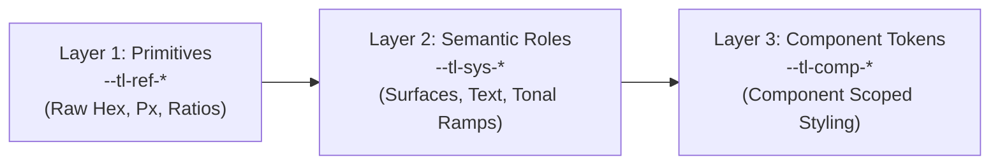

# Trilayer Design System — Design & Token Specification (DESIGN.md)

> **Architectural Standard for Designers & Front-End Engineers**  
> Synthesized from installed engineering skills: `accessibility-engineer`, `creative-coder`, `frontend-implementation`, `ui-designer`, and `usability-psychologist`.

---

## 1. Core Principles & Philosophy

1. **UI is Decision Support, Not Decoration** (`ui-designer`, `usability-psychologist`):
   - Every element must guide users toward their goals with minimum cognitive load and zero unnecessary friction.
   - Recognition over recall: provide clear labels, sensible defaults, and inline helper text.
2. **Translate, Don’t Transcribe** (`frontend-implementation`):
   - Design tool pixel values are references, not implementation absolutes. Implementations use strict spatial scales, proportional ratios, and fluid constraints (`clamp()`, `min()`, `max()`).
   - Never fix heights unless specified by strict touch target or media requirements.
3. **Structure Over Margin Tweaks** (`frontend-implementation`):
   - Align elements using layout containers (`display: flex`, `display: grid`) and `gap`. Never scatter ad-hoc negative margins or magic numbers.
4. **Native Elements & Minimal ARIA First** (`accessibility-engineer`):
   - Always choose native HTML elements (`<button>`, `<a href>`, `<input>`, `<dialog>`) over custom `<div>` substitutes.
   - Keyboard operability and visible focus rings (`:focus-visible`) are mandatory Definition of Done criteria.
5. **Motion is Meaning, Not Noise** (`creative-coder`):
   - Animate state transitions and timing, never decorative elements for the sake of animation.
   - Respect `prefers-reduced-motion` unconditionally. Only animate GPU-composited properties (`transform`, `opacity`).

---

## 2. Strict 3-Tier Token Architecture

Trilayer enforces an uncompromised 3-layer token contract:



### Architectural Rules
- **Layer 1 (`--tl-ref-*`)**: Raw color ramps (50–950), raw spacing units, and raw radii. **Never referenced directly by component CSS.**
- **Layer 2 (`--tl-sys-*`)**: Contextual roles (`--tl-sys-color-surface`, `--tl-sys-color-primary`, `--tl-sys-space-md`). Dynamic across dark mode and density settings.
- **Layer 3 (`--tl-comp-*`)**: Scoped to individual components (`--tl-comp-button-primary-bg`, `--tl-comp-avatar-radius`). **Only references Layer 2.**

---

## 3. Typography System

### 3.1 Font Families
| Role | Family Stack | Token Variable | Usage |
| :--- | :--- | :--- | :--- |
| **Heading** | `Inter`, system-ui, -apple-system, sans-serif | `var(--tl-sys-font-family-heading)` | Page titles, section headers, dialog titles |
| **Body** | `Inter`, system-ui, -apple-system, sans-serif | `var(--tl-sys-font-family-body)` | Paragraphs, labels, descriptions, table cells |
| **Code / Data** | `JetBrains Mono`, `Fira Code`, monospace | `var(--tl-sys-font-family-code)` | Tokens, code snippets, keyboard shortcuts, version pills |

### 3.2 Typescale Hierarchy
| Typescale Role | Size | Line Height | Weight | Measure / Max Width |
| :--- | :--- | :--- | :--- | :--- |
| **Display Large** | `clamp(34px, 5vw, 54px)` | `1.15` | `800` | `25ch` (Balance wrap) |
| **Headline Large**| `clamp(24px, 3.5vw, 32px)`| `1.25` | `700` | `35ch` (Balance wrap) |
| **Headline Medium**| `24px` | `1.35` | `700` | `45ch` |
| **Title Large** | `20px` | `1.40` | `600` | `55ch` |
| **Title Medium**| `16px` | `1.40` | `600` | `60ch` |
| **Body Large** | `16px` | `1.60` | `400` | `60ch–75ch` (Optimal reading) |
| **Body Medium** | `14px` | `1.50` | `400` | `60ch` |
| **Body Small** | `13px` | `1.40` | `400` | `55ch` |
| **Label Medium**| `12px` | `1.35` | `600` | UI badges, tags, table headers |
| **Label Caps** | `11px` | `1.00` | `700` | Eyebrow tags, uppercase metadata |

---

## 4. Color Tokens & Contrast Standards

### 4.1 Contrast Compliance (WCAG 2.2 AA / AAA)
- **Normal Text ($\ge 4.5:1$)**: All body and label copy against container surfaces.
- **Large Text / Headings ($\ge 3.0:1$)**: Text $\ge 24\text{px}$ or bold $\ge 18.5\text{px}$.
- **UI Components & Borders ($\ge 3.0:1$)**: Form outlines, active switches, and interactive states against surrounding canvas.

### 4.2 Semantic Color Spectrum
| Semantic Role | Dark Canvas Token | Intent & Meaning |
| :--- | :--- | :--- |
| **Canvas Surface** | `--tl-sys-color-surface` | Deepest root canvas (`#09090B` / OLED black) |
| **Surface Containers** | `--tl-sys-color-surface-container` | Cards, panels, dialogs, drawers |
| **Primary (Brand)** | `--tl-sys-color-primary` | High-emphasis interactive call-to-action (`#6366F1`) |
| **Success** | `--tl-sys-color-success` | Confirmations, healthy deployments, online presence (`#34D399`) |
| **Warning** | `--tl-sys-color-warning` | Non-blocking alerts, deprecations, pending review (`#FBBF24`) |
| **Error / Danger** | `--tl-sys-color-error` | Destructive operations, broken states, critical errors (`#F43F5E`) |
| **Information** | `--tl-sys-color-link` / `--tl-sys-color-primary` | Contextual hints, documentation tips, links |

---

## 5. Spatial Rhythm & Layout Rules (8pt Grid)

### 5.1 Spacing Scale
| Token | Step | Value | Application |
| :--- | :--- | :--- | :--- |
| `--tl-sys-space-2xs` | 0.5 | `2px` | Micro-gaps, hairline borders |
| `--tl-sys-space-xs` | 1 | `4px` | Badge padding-y, icon-to-label gaps |
| `--tl-sys-space-sm` | 2 | `8px` | Control padding-y, button gaps, chip spacing |
| `--tl-sys-space-md` | 4 | `16px` | Card internal padding, stack gaps, input padding |
| `--tl-sys-space-lg` | 6 | `24px` | Section sub-gaps, modal padding, mobile gutters |
| `--tl-sys-space-xl` | 8 | `32px` | Grid column gutters, container margins |
| `--tl-sys-space-2xl`| 12 | `48px` | Vertical section dividers |
| `--tl-sys-space-3xl`| 16 | `64px` | Desktop hero section spacing |

### 5.2 Responsive Breakpoint Architecture
- **Mobile (`< 768px`)**: Single-column stack (`grid-template-columns: 1fr`), horizontal scroll snap for swatches, full-width touch actions ($\ge 44\text{px}$).
- **Tablet (`768px – 1023px`)**: 2-column card layouts, drawer navigation.
- **Desktop (`1024px – 1919px`)**: Persistent sidebar, multi-column grid, compact control heights (36px–38px).
- **Ultrawide (`>= 1920px`)**: Constrained reading measure (`max-width: 1440px`, centered) to prevent unreadable line lengths.

---

## 6. Interaction & Motion Guidelines

### 6.1 Tactile Physics
- **Hover Elevation (`.tl-has-lift`)**:
  ```css
  .tl-has-lift {
    transition: transform var(--tl-sys-motion-duration-quick) ease,
                box-shadow var(--tl-sys-motion-duration-quick) ease,
                border-color var(--tl-sys-motion-duration-quick) ease;
  }
  .tl-has-lift:hover {
    transform: translateY(-2px);
    box-shadow: 0 10px 24px -4px rgba(0, 0, 0, 0.45);
    border-color: color-mix(in srgb, var(--tl-sys-color-outline) 80%, transparent);
  }
  ```
- **Shimmer Pulse (`tl-skeleton`)**: Smooth linear gradient translation (`transform: translateX(100%)`).

### 6.2 Reduced Motion Fallback
```css
@media (prefers-reduced-motion: reduce) {
  *, *::before, *::after {
    animation-duration: 0.01ms !important;
    animation-iteration-count: 1 !important;
    transition-duration: 0.01ms !important;
    scroll-behavior: auto !important;
  }
}
```

---

## 7. Accessibility & Touch Ergonomics Baseline

- **Minimum Touch Target**: Controls, buttons, and navigation links must meet $\ge 44 \times 44\text{px}$ on coarse pointers and mobile viewports (`@media (pointer: coarse), (max-width: 767px)`).
- **Visible Focus Rings**:
  ```css
  :focus-visible {
    outline: 2px solid var(--tl-sys-color-primary);
    outline-offset: 2px;
  }
  ```
- **Form Integrity**: Every `<input>` must have a dedicated matching `<label for="...">`. Error descriptions must bind via `aria-describedby`.
- **Keyboard Traps & Modals**: Modals must trap Tab focus inside the active dialog and restore focus to the trigger on `Escape` or close.

---

## 8. Complete Component State Contract

Every component in Trilayer must formally specify and implement the **8 Canonical States**:

1. **Default**: Baseline idle resting state.
2. **Hover**: Visual affordance indicating interactivity (`translateY(-2px)`, subtle tint).
3. **Active**: Pressed / physical feedback state.
4. **Focus-Visible**: High-contrast outline ring for keyboard navigation.
5. **Disabled**: `opacity: 0.5`, `pointer-events: none`, native `disabled` attribute.
6. **Loading**: Inline spinner or shimmering skeleton placeholder preventing double-submission.
7. **Error**: Accessible error border, descriptive copy, and status alert icons.
8. **Empty**: Contextual illustration/icon, clear explanation, and primary action button to create initial data.
